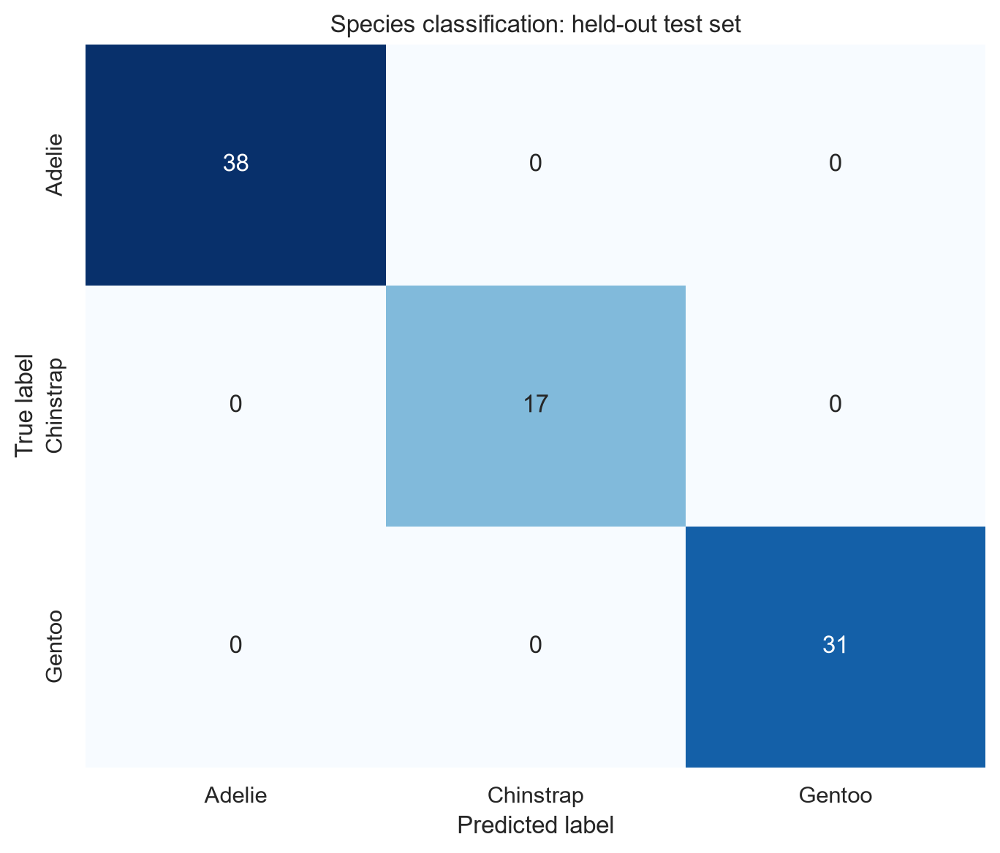

# Byron

Data science student interested in reproducible analysis and clear communication.

[GitHub](https://github.com/ByronLen) | [Project repository](https://github.com/ByronLen/data-science-project) | [Live site](https://byronlen.github.io/data-science-portfolio/)

## About

I am a data science student interested in reproducible analysis and clear communication.

## Skills

<!-- These are tools and methods demonstrated in this project, not a claim of professional proficiency. -->
- **Programming:** Python.
- **Data analysis:** pandas, NumPy, data cleaning, exploratory data analysis, model evaluation, scikit-learn.
- **Visualization:** Matplotlib, Seaborn.
- **Tools:** Git/GitHub; GitHub Pages/Jekyll (this site).

## Penguin Morphometrics: Can Four Measurements Identify a Species?

Analysis complete · 3 visualizations · Peer review: feedback received and revision completed

### Purpose

Can bill length, bill depth, flipper length, and body mass distinguish Adelie, Chinstrap, and Gentoo penguins? Comparing these measurements makes it possible to examine variation among species and individuals, then contrast descriptive differences with held-out prediction. This reproducible example shows why strong classification still needs careful limits.

### Data

Palmer Penguins contains 344 observations collected by Kristen Gorman and Palmer Station LTER on three Antarctic islands during 2007–2009; the data are CC0 and an offline copy is included in the [project repository](https://github.com/ByronLen/data-science-project).

### Methods

- Validate the schema, convert four measurement columns to numeric, and remove two incomplete rows, leaving 342 complete-case observations; no mean imputation.
- Summarize distributions by species and calculate overall and within-species Pearson correlations; use descriptive eta-squared to compare measurement separation on those 342 observations.
- Use only bill length, bill depth, flipper length, and body mass in a StandardScaler + LogisticRegression pipeline with a stratified 75/25 split (256 training, 86 test; random_state=42).
- Run five-fold stratified cross-validation on the training set only; fit preprocessing within each fold and report test accuracy, macro F1, per-class metrics, and confusion counts without test-based tuning.

### Findings

These four body measurements distinguish the three species well in this dataset, but strong results here do not guarantee accurate predictions for penguins elsewhere.

- Gentoo are generally heavier, with longer flippers and shallower bills. Their average body mass is about 5.08 kg, compared with about 3.70 kg for Adelie and 3.73 kg for Chinstrap (Figure 1).
- Adelie and Chinstrap have similar body masses, but their average bill lengths differ: about 38.8 mm versus 48.8 mm. The distributions still overlap (Figures 1–2).
- The model correctly classified all 86 test observations in this single split. **A perfect test score does not mean perfect performance on external data.** Training-only cross-validation accuracy was about 98.0%, with a standard deviation of 1.2 percentage points (Figure 3).

Combining species can hide differences in within-species relationships. Figure 2 illustrates this distinction; the project README and results files retain the detailed statistics.

### Limitations

- Only three species, three islands, and 2007–2009 are represented. There are 342 complete-case observations and only 68 Chinstrap records; results do not generalize to all penguins or later years.
- These observational data cannot explain causes or isolate environmental, sex, or age effects. High accuracy demonstrates distinguishability rather than biological importance.
- One holdout split can vary; training-only cross-validation only partly addresses this, and there is no external validation set.

[Project repository](https://github.com/ByronLen/data-science-project) · [Project README](https://github.com/ByronLen/data-science-project/blob/main/README.md) · [Dataset page](https://allisonhorst.github.io/palmerpenguins/) · [Dataset DOI](https://doi.org/10.5281/zenodo.3960218)

## Figures

  

<em>Figure 1. Gentoo has greater body mass and shallower bills on average, while Adelie and Chinstrap overlap in mass and bill depth.</em>

  

<em>Figure 2. Species-specific fits reveal positive within-species associations and overlap; pooled association also reflects species differences and does not establish causation.</em>

  

<em>Figure 3. All 86 held-out observations are classified correctly in this fixed split; perfect accuracy here does not establish performance on external populations.</em>

## Project status

| Component | Status |
|---|---|
| Analysis code and README | Complete |
| Two or more visualizations | Complete |
| GitHub Pages site | Live — verified 2026-10-21 |
| Peer feedback and revision | Complete — 2026-10-21 |
| Moodle post | [Posted — 2026-10-21](https://ummoodle.um.edu.mo/mod/forum/discuss.php?d=467138) |

## Peer feedback

Feedback supplied by the author on 2026-10-21; reviewer kept anonymous.

- **Understanding:** The reviewer identified the four-measurement classification question and the distinction between descriptive group differences and predictive accuracy.
- **Findings and limitations:** The reviewer understood the Gentoo differences, the Adelie/Chinstrap comparison, the 86 correct test predictions, and the sampling and external-validity limitations.
- **Suggestion accepted:** Findings were too number-dense, and three decimal places made the main message harder to identify. Lead with a plain-language conclusion, retain only a few key numbers, and place the external-validation warning next to the test result.
- **Change made:** Rewrote Findings for non-specialist readers, rounded summary values, and moved detailed statistics behind the project README/results links. Analysis code, data, figures, and original metrics were not changed.

Revision record: see the [commit history for this page](https://github.com/ByronLen/data-science-portfolio/commits/main/index.md), commit titled "docs: simplify findings and record peer feedback".

## What I learned

I learned to separate descriptive differences from predictive performance and to keep scaling inside the training pipeline. Comparing pooled and within-species correlations showed me why a strong overall association can hide group structure. I also learned to document limitations, check relative image paths, and separate analysis quality from publication status.

## Contact

[GitHub: ByronLen](https://github.com/ByronLen) · [Portfolio repository](https://github.com/ByronLen/data-science-portfolio)

Last updated: 2026-10-21.

Built with human direction and AI assistance; see the [project README](https://github.com/ByronLen/data-science-project/blob/main/README.md#ai-assistance) for details.
